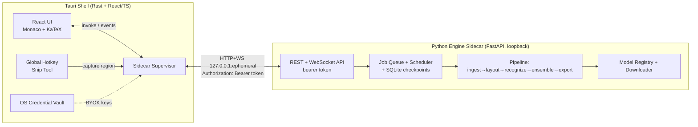
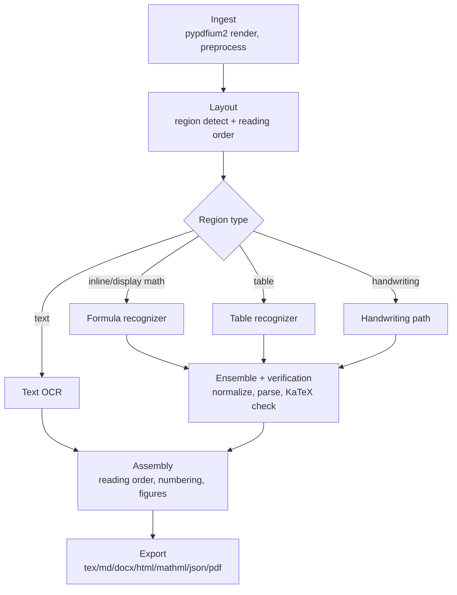
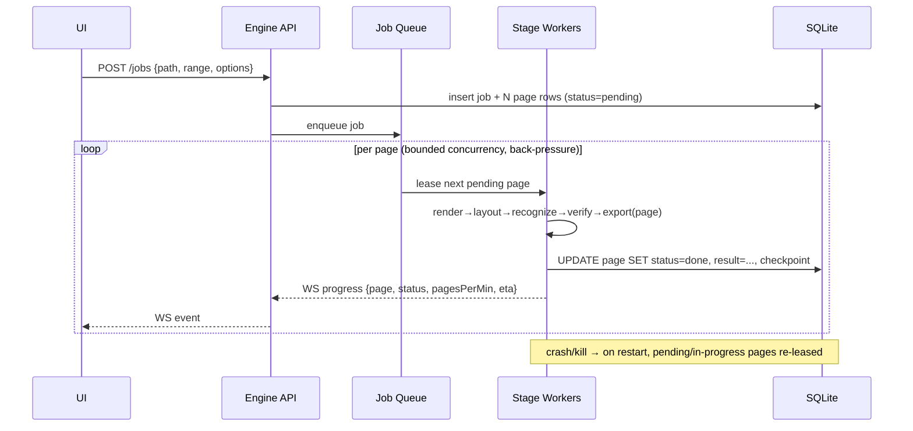
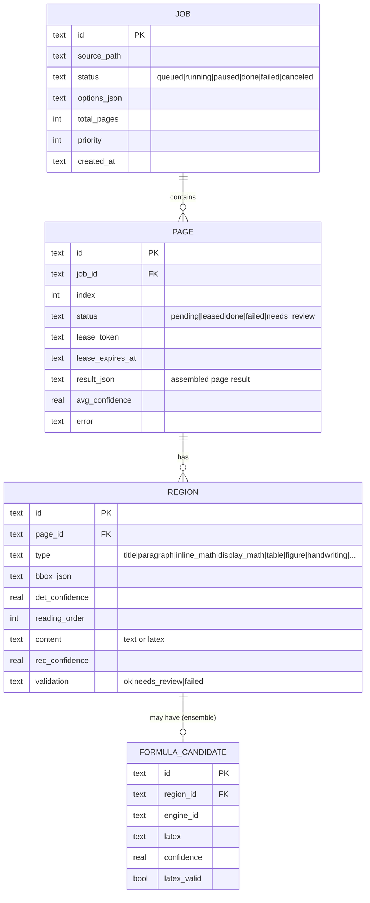

# Texora — Design

Status: Draft v1. Traces to `requirements.md` (IDs in parentheses).

---

## 1. Architecture Overview

Texora is a two-process desktop application:

1. **Shell (Rust + Tauri v2 2.12.x)** — windowing, global hotkeys, OS credential vault, file
   dialogs, process supervision of the sidecar, and the React/TypeScript UI. The shell owns no ML
   logic; it is a thin, secure client of the engine.
2. **Engine (Python 3.11 sidecar)** — a local-only FastAPI server bound to `127.0.0.1` on an
   ephemeral port, protected by a per-session bearer token. It owns ingestion, layout, recognition,
   ensemble/verification, export, and the job/checkpoint system. Packaged with PyInstaller into a
   single self-contained binary embedded as a Tauri `externalBin` sidecar, so the end user never
   installs Python (R-INST-1).



**Why a sidecar HTTP/WS server rather than stdin/stdout?** The pipeline is long-running, streaming,
and concurrent (R-JOB-4). A loopback FastAPI server gives us WebSocket progress events, multiple
concurrent requests (snip while a batch runs), and a clean language boundary, while
`externalBin` keeps packaging to one binary. Security is handled by loopback binding + per-session
token (R-SEC-2).

### 1.1 Process lifecycle & security

- On launch the shell generates a 256-bit random token, picks a free loopback port, and spawns the
  sidecar passing `--host 127.0.0.1 --port <p> --token <t>` (token also via env to avoid process
  listing leakage where possible). (R-INST-5, R-SEC-2)
- The sidecar refuses any request missing the token and binds only to loopback.
- The supervisor health-checks `/healthz`; on crash it restarts with backoff and surfaces status to
  the UI; the UI stays responsive regardless (R-INST-6).
- Shutdown is graceful: in-flight pages checkpoint before exit (R-JOB-2).

---

## 2. Engine Pipeline



The pipeline is defined by `pipeline.yaml`: each stage names an **engine adapter** by id. Adapters
implement a stable Python Protocol so engines are swappable and ensemble-able without UI changes
(R-HW-3, R-REC-2, R-QA-2).

```python
# engine/texora_engine/recognizers/base.py (interface sketch)
class FormulaRecognizer(Protocol):
    id: str
    def recognize(self, img: Image, ctx: RegionContext) -> FormulaResult: ...
    # FormulaResult: latex: str, confidence: float, token_logprobs: list[float] | None
```

### 2.1 Stage A — Ingestion (R-ING)

- **Renderer:** `pypdfium2` (PDFium, BSD-3/Apache-2.0) as the DEFAULT — avoids the PyMuPDF AGPL
  trap for a redistributable installer (R-LIC-2). Adaptive DPI 220–300, auto-raise on small-font
  detection. PyMuPDF is available as an *optional* backend behind an explicit license acknowledgment
  for users who only run locally.
- **Image inputs:** Pillow + pillow-heif (HEIC). Multi-page TIFF via Pillow.
- **Preprocessing:** OpenCV (Apache-2.0 for `opencv-python`'s own code; note bundled codecs) for
  deskew, denoise, adaptive binarization, perspective correction, auto-crop. Each step toggleable.
- **Born-digital detection:** inspect text layer coverage + glyph integrity; if reliable, keep text
  for prose but still route math regions through formula recognition (R-ING-3).

### 2.2 Stage B — Layout (R-LAY)

- **Default:** `DocLayout-YOLO` (opendatalab) for region detection — fast, strong on documents.
  License to be pinned in `docs/LICENSES.md` (verify at adoption; some YOLO lineages are AGPL via
  Ultralytics — this is a **licensing risk flagged for M3/M7**; if AGPL, keep it opt-in and seek a
  permissive layout model as the shipped default).
- **Reading order:** geometric XY-cut + column detection, refined by region types; handles
  multi-column and side-by-side equation numbers (R-LAY-2).

### 2.3 Stage C — Recognition (R-REC)

Engine candidates evaluated by benchmark (R-QA-2), not hype. Default picks are provisional until
M7 numbers land.

| Stage | Candidates | Provisional default | License note |
|---|---|---|---|
| Text OCR | PaddleOCR PP-OCRv5, Surya, Tesseract | PP-OCRv5 (perm.) / Tesseract fallback (Apache-2.0) | Surya code GPL + weights non-commercial RAIL → **opt-in only** |
| Formula | UniMERNet, PP-FormulaNet(-S/-L), Texify, pix2tex, VLM | PP-FormulaNet-S (speed) / -L (accuracy) | UniMERNet pkg Apache-2.0; verify weights at adoption |
| Table | SLANet (PaddleOCR), TableFormer, VLM | SLANet | verify |
| Handwriting | VLM (Qwen2.5-VL/Qwen3-VL/GOT-OCR2.0), CROHME-tuned | VLM via local runtime | weights licenses vary → pin per-model |
| Tie-breaker | local VLM via llama.cpp/transformers; BYOK (opt-in) | low-confidence second pass | BYOK egress is explicit (R-BYOK-3) |

- **Confidence + verification loop (R-REC-5/6):** every formula gets a confidence (decoder
  logprobs where available, else model score). If `confidence < threshold`: (1) re-run with a
  second engine; (2) compare candidates by normalized-LaTeX edit similarity; (3) validate each by
  AST/brace/`\left\right`/environment checks (`pylatexenc` + custom) and a KaTeX render check;
  (4) pick best by vote of {validity, confidence, agreement}. Unresolved → `needs_review`.
- **Normalization (R-REC-7):** canonicalize `\frac`/`\dfrac`, spacing, `\operatorname`, `\mathrm`;
  fix OCR confusions (l/1/I, O/0, ×/x, ν/v, Σ/∑) with rules that preserve compilability.
- **No fabrication (R-REC-8):** a failed region yields `status=failed`/`needs_review`, never a
  guessed string presented as confident output.

### 2.4 Stage D — Assembly & Export (R-EXP)

- Assembly rebuilds reading order, equation numbering, figure crops, tables.
- Exporters: `.tex` (with preamble templates), Markdown, DOCX via OMML (LaTeX→MathML→OMML using
  bundled XSLT, or `latex2mathml` + MML→OMML XSLT), HTML (KaTeX), MathML, AsciiMath, plain text,
  JSON (bboxes/confidence/order), searchable PDF (invisible text layer over rendered pages).
- Golden-file tests assert LaTeX compiles and DOCX contains editable OMML (R-EXP-4, R-QA-3).

---

## 3. Unlimited Pages: Jobs, Streaming, Checkpointing (R-JOB)



- **Constant memory (R-JOB-1):** pages are rendered and processed one bounded batch at a time; a
  semaphore caps in-flight pages. Rendered bitmaps and intermediates are freed per page. Never
  materialize all pages. Proven by a 5,000-page synthetic PDF memory test.
- **Checkpointing (R-JOB-2):** each page is an atomic SQLite row transition
  `pending → leased → done|failed`. A lease has a heartbeat/expiry; on restart, `leased` rows whose
  lease expired revert to `pending`. Idempotent per-page export (write to temp, atomic rename) so a
  resumed page cannot duplicate output.
- **Concurrency (R-JOB-4):** a GPU batch scheduler groups formula/text crops into fp16 batches; a
  CPU worker pool sized to cores handles render/preprocess/export. Sizes configurable.
- **Failure isolation (R-JOB-6, R-SEC-3):** per-page timeout + resource guard; a hostile/broken
  page is marked `failed` and the job continues; failed pages are retryable in isolation.
- **Incremental output (R-JOB-5):** exporters append/patch per-page so results appear as they land.

---

## 4. Data Model (SQLite)



Plus: `CORRECTION` (user corrections, local dictionary, R-UI-9), `MODEL` (registry: id, version,
sha256, size, license, path, R-INST-3), `SETTING` (key/value). FTS5 virtual table over recognized
text/LaTeX for library search (R-UI-1).

---

## 5. Shell ↔ Engine API (loopback, token-auth)

- `GET /healthz` — liveness.
- `GET /hardware` — detected devices + current selection (R-HW-3).
- `GET /models`, `POST /models/{id}:download` (SSE/WS progress), `DELETE /models/{id}`.
- `POST /recognize/snip` — single image → formula result (snip tool fast path, R-UI-2).
- `POST /jobs`, `GET /jobs`, `GET /jobs/{id}`, `POST /jobs/{id}:pause|resume|cancel|reprioritize`,
  `POST /jobs/{id}/pages:retry-failed`.
- `GET /jobs/{id}/export?format=...` — stream export artifact.
- `WS /jobs/{id}/events` — progress, per-page status, ETA, pages/min (R-JOB-5).
- `POST /compare` — run sample across engines (R-UI-8).
- All non-health routes require `Authorization: Bearer <session-token>`.

---

## 6. Frontend Architecture

- React + TypeScript + Vite + Tailwind; Zustand (or Redux Toolkit) for job/UI state; TanStack Query
  for engine calls; a thin typed client wrapping Tauri `invoke`/events.
- Monaco editor for LaTeX/Markdown; KaTeX for live preview (MathJax fallback for unsupported
  macros). Canvas/overlay layer for bbox↔output linking (R-UI-3).
- i18n via `i18next`, default `id`, `en` provided (R-UI-10). Theme tokens for dark/light +
  high-contrast (R-UI-7/11).

---

## 7. Packaging & Distribution

- Sidecar frozen with PyInstaller per-platform; model weights are NOT bundled by default (size +
  licensing). First-run downloader fetches pinned, checksummed weights; an offline bundle importer
  covers air-gapped installs (R-INST-2/3/4).
- Tauri bundles `.msi`/`.exe` (Windows), `.AppImage` (Linux), `.dmg` (macOS arm64). CI builds the
  Windows installer in M1.

---

## 8. Key Decisions & Trade-offs (ADR summary)

- **ADR-1 Loopback HTTP/WS sidecar over stdio** — enables streaming/concurrency; cost: a local
  port + token (mitigated by loopback-only bind).
- **ADR-2 pypdfium2 as default renderer, PyMuPDF opt-in** — avoids AGPL redistribution risk
  (R-LIC-2); cost: pypdfium2 has fewer high-level helpers, so some extraction logic is hand-rolled.
- **ADR-3 Engine-adapter Protocol + `pipeline.yaml`** — swappable/ensemble engines, benchmark-driven
  defaults; cost: more abstraction up front.
- **ADR-4 Per-page SQLite state machine with leases** — gives crash-safe resume and failure
  isolation; cost: careful idempotent export.
- **ADR-5 PyInstaller single-binary sidecar** — no end-user Python; cost: large binary, per-platform
  freeze matrix in CI.
- **ADR-6 Permissive-first model defaults** — Surya/any GPL/non-commercial weights are opt-in, never
  the shipped default; cost: provisional defaults may trade some accuracy until M7 benchmarks pick
  the best *permissive* combination. Documented honestly in `docs/BENCHMARKS.md`.

## 9. Open Risks (tracked to tasks)

- **Layout model licensing** (DocLayout-YOLO / Ultralytics lineage possibly AGPL) → verify in M3,
  resolve default in M7.
- **VLM handwriting weights** licensing varies per model → pin per-model, personal-use vs redistri-
  bute verdict in `docs/LICENSES.md`.
- **DOCX OMML fidelity** across Word versions → golden-file tests in M6.
- **CPU-only performance** may fall well short of GPU targets → measured + clearly communicated, not
  hidden (R-PERF-3).
